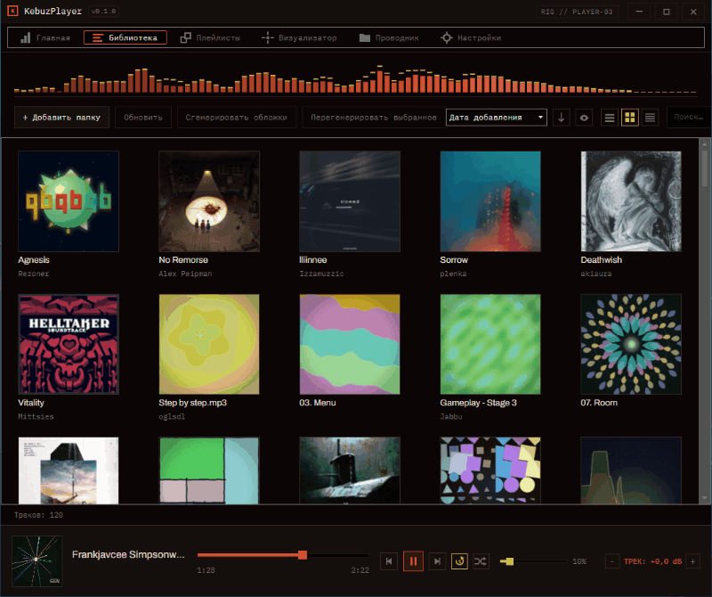
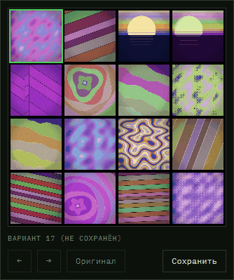
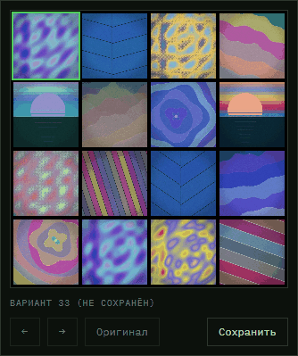
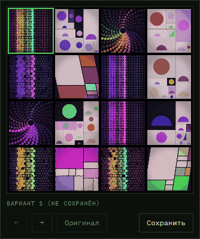
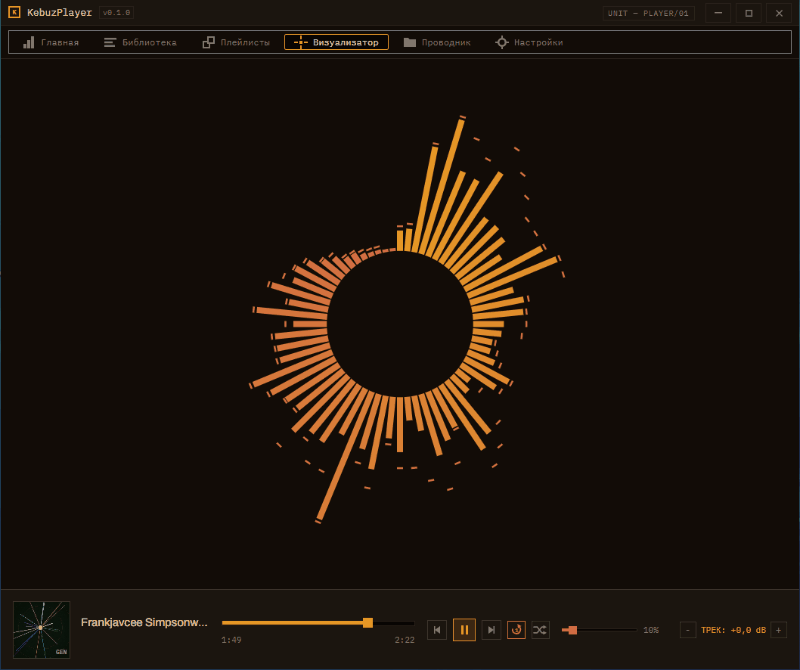
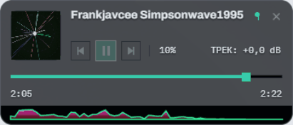

<div align="center">

# KebuzPlayer

**A music player for the files on your own disk.**
Your own library, a spectrum visualizer, and cover art generated from the sound of the track itself.

[](#)
[](https://dotnet.microsoft.com/)
[](https://avaloniaui.net/)
[](LICENSE)

[English](README.md) | [Русский](README.ru.md)



</div>

---

## Why

For a collection that lives on a disk: no account, no network, no cloud. The library is a local SQLite database, the settings are a single JSON file. Fully private: the player works offline. The only network request is a check for a new version on GitHub, once a day, and it can be turned off in the settings.

The key features answer problems I kept running into in other audio players: covers that are not identical grey notes, a visualizer you can put in several places at once, and themes worth sitting in.

The interface is in English and Russian: on first start the player picks Russian on a Russian Windows and English otherwise, and the language can be switched in the settings at any time.

## What it does

### Cover art generated from the audio

A track without a cover does not get a grey note icon. The player analyses the audio itself - spectrum, rhythm, segment structure - and draws an image from it. The same track always yields the same picture, so your library stays recognisable. You can regenerate any cover and dial the amount of chaos up or down.

<p align="center">
  
  
  
</p>

### A visualizer in four places at once

Fourteen styles, eight colour modes, configured separately for the tab, the strip above the library, the overlay and the Home widget. Frame rate is yours to pick: 15 to 120, or whatever your monitor runs at. F11 or one button takes it fullscreen on the monitor the window is on.

### A library that does not lose things

Several watched folders, three view modes, sorting, search, tag and filename editing, deletion to the recycle bin. Switch a folder off and its tracks hide without being touched. Move a folder on disk and point the player at the new place: play counts, covers, playlists and history follow it. If a file is deleted by accident, the track's data is not erased and waits for the file to come back.



### An overlay that behaves like a system OSD

A compact window above all applications, summoned with the media keys: what is playing, progress, transport, volume. It hides itself like the Windows volume popup, or pins if you want it to stay.



### The rest

- **Home** - a grid of widgets you arrange yourself: recent, most played, playlists, continue listening, visualizer.
- **Playlists** with manual ordering, their own view mode and a collage cover.
- **Explorer** - two panes with independent roots, file transfer between them and from Windows, playback straight from a folder.
- **Per-track volume** - ReplayGain from tags plus your own offset, so quiet records stop disappearing.
- **Seven themes**, each a full palette rather than a dark/light switch.

## Install

Grab an archive from [Releases](../../releases):

| Download | What it is |
| --- | --- |
| `KebuzPlayer-Setup-win-x64.exe` | Installer. Small, fetches the .NET runtime if you do not have it. |
| `KebuzPlayer-win-x64-portable.zip` | Everything inside, no runtime needed. Unpack and run. |
| `KebuzPlayer-win-x64-lite.zip` | The same thing without the runtime: needs [.NET 8 Runtime](https://dotnet.microsoft.com/download/dotnet/8.0/runtime) installed. About 15 MB. |

Both archives ship a `kebuz.portable` marker next to the executable, which keeps the database and settings in a `Data` folder inside the program folder instead of your user profile. Delete the marker and it behaves like an installed copy.

**Portable data.** Everything the player remembers (library, playlists, play counts, covers, settings) lives in the `Data` folder inside the `KebuzPlayer` folder. Move or back up the whole folder and the library goes with it. To update, unpack the new archive over the old folder: `Data` is not in the archive and stays. Deleting `Data` resets the player; your music files are never touched.

**SmartScreen.** The files are not signed yet, so Windows may warn on first start: *More info > Run anyway*. You can check a download against `checksums.txt`.

## Build from source

.NET 8 SDK required.

```
dotnet build KebuzPlayer.sln
dotnet run --project KebuzPlayer
dotnet test KebuzPlayer.Core.Tests
```

## Where the data lives

| What | Where |
| --- | --- |
| Library database | `%LOCALAPPDATA%\Kebuz\KebuzPlayer` |
| Settings | `%APPDATA%\Kebuz\KebuzPlayer` |
| Both, in portable mode | `Data\` next to the executable |

## Layout

| Project | What is inside |
| --- | --- |
| `KebuzPlayer.Core` | No UI at all: playback (NAudio), database (SQLite), tags (TagLibSharp), cover generation, spectrum analysis. |
| `KebuzPlayer` | The interface, on Avalonia. |
| `KebuzPlayer.Core.Tests` | xUnit tests. |

## License

MIT, see [LICENSE](LICENSE).
